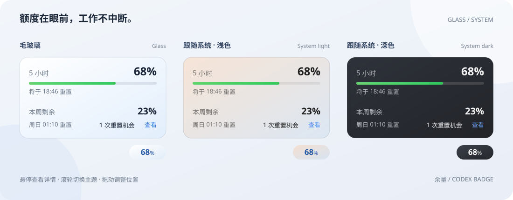

  

<h1 align="center">余量 · Codex Badge</h1>

<strong>Codex 还剩多少，一眼就知道。</strong>

Windows 上的 Codex 额度胶囊 · Codex usage monitor for Windows

  
  
  
  

  <a href="#下载">下载</a> · <a href="#开始使用">开始使用</a> · <a href="#日常操作">日常操作</a> · <a href="https://github.com/returnk/codex-usage-badge/issues">反馈</a> · <a href="docs/README.en.md">English</a>

把剩余额度留在眼前，把注意力留给工作。**余量**贴合 Codex 侧栏，根据接口返回优先显示 5 小时剩余百分比，只有周窗口时显示本周剩余；悬停展开本周剩余、重置时间和重置机会，不必切换页面。

  
   
  当前界面风格示意 · 示例数据 · 两个主题选项：毛玻璃 / 跟随系统

## 下载

当前本地版本统一为 **v0.3.5**：包含额度恢复识别改进、更新控件避让修正和需账号授权的“临期用卡”，尚未上传 GitHub。[本地版本说明](CodexBadge.Tauri/docs/releases/v0.3.5.md)。以下链接仍指向已公开的 v0.3.4。

**v0.3.4** · Windows 10 / 11 x64 · 正式发布版本

| 安装版 · 推荐 | 便携版 |
| --- | --- |
| [下载安装器](https://github.com/returnk/codex-usage-badge/releases/download/v0.3.4/Codex.Badge_0.3.4_x64-setup.exe) | [下载 ZIP](https://github.com/returnk/codex-usage-badge/releases/download/v0.3.4/CodexBadge-v0.3.4-windows-x64-portable.zip) |
| 按提示安装后运行 | 解压后运行 `codex-badge-tauri.exe` |

[更新说明](https://github.com/returnk/codex-usage-badge/releases/tag/v0.3.4) · [SHA-256 校验](https://github.com/returnk/codex-usage-badge/releases/download/v0.3.4/SHA256SUMS.txt)

无需 .NET。需要 **WebView2 Runtime**、已登录的 Codex Windows 桌面客户端和可用的 Codex CLI；安装器可引导下载 WebView2。程序尚未签名，首次运行可能出现 Windows 安全提示，请确认来自本仓库。

## 开始使用

1. 安装或解压，运行余量。
2. 打开已登录的 Codex，胶囊自动出现。
3. 右键胶囊或托盘图标开启**置顶模式**；在**设置 ›**中选择开机启动或系统通知。

余量在后台运行时，会随 Codex 打开而显示、退出而收起；从托盘选择“退出”后，需要手动重新启动余量。

## 日常操作

| 操作 | 效果 |
| --- | --- |
| 悬停胶囊 | 展开 5 小时、本周剩余和重置时间 |
| 点击“查看” | 查看重置机会的到期时间（有可用详情时显示） |
| 滚动鼠标滚轮 | 切换**毛玻璃 / 跟随系统**；系统主题自动适配明暗 |
| 拖动胶囊 | 调整位置，普通模式和置顶模式分别记忆 |
| 右键胶囊或托盘 | 置顶模式、设置 ›、退出；设置内可切换开机启动和系统通知 |
| 双击胶囊 | 恢复当前模式的默认位置 |

普通模式随 Codex 最小化隐藏；置顶模式可在 Codex 最小化时继续显示。Codex 退出后，两种模式都会收起。

## 常见问题

**没有看到胶囊？** 确认余量正在运行、ChatGPT/Codex 主窗口已经打开。普通模式下，客户端最小化时不会显示。v0.3.3 已适配新版 ChatGPT 的布局变化；胶囊位置不合适时可双击恢复默认位置。

**显示 `--%`？** 确认 Codex 已登录，且 Codex CLI 可用。找不到 CLI 时，可将环境变量 `CODEX_BADGE_CLI` 设置为 `codex.exe` 的完整路径。

**更新或移动便携版？** 先关闭开机启动，再退出正在运行的版本；运行新版本后按需重新开启。开机启动会记住程序所在路径。从 v0.2.x 升级需重新设置主题与位置。

本版改进悬停时的额度同步与旧读数提示，修复更新错误提示，并收紧卸载清理范围。自动检查和用户日常测试不等于多机、混合 DPI 或完整安装升级验收。[查看发布说明](CodexBadge.Tauri/docs/releases/v0.3.4.md)

## 隐私与反馈

通过本机 `codex app-server` 只读获取额度，不读取 `auth.json`、不发送模型请求，不上传登录凭据。设置和诊断日志保存在本机 `%LOCALAPPDATA%\CodexBadge`。

发现问题？[提交反馈](https://github.com/returnk/codex-usage-badge/issues/new/choose)，附上复现步骤、显示缩放和主题即可。截图或日志请先检查隐私，不要上传凭据。

[开发与构建](CodexBadge.Tauri/README.md) · [MIT License](LICENSE)

第三方开源工具，非 OpenAI 官方产品。

## v0.3.4 更新

悬停时按需补读旧额度，缓存数据增加轻量状态提示；更新操作失败的提示不再被界面刷新覆盖。卸载仅移除属于当前安装的启动项和 Tauri 数据，升级继续保留设置。保持原有毛玻璃与跟随系统主题。安装版支持用户主动点击一键更新；便携版请从发布页下载 ZIP 手动替换。不会自动检查、下载或安装。更新包使用独立签名校验，但这不等于 Windows Authenticode 代码签名。

[English overview](docs/README.en.md) · 如果余量对你有帮助，欢迎给项目一个 Star。
